

  <picture>
    <source media="(prefers-color-scheme: dark)" srcset="assets/header-titleblock-dark.svg">
    <source media="(prefers-color-scheme: light)" srcset="assets/header-titleblock-light.svg">
    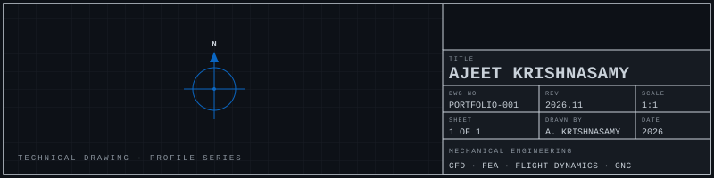
  </picture>

I'm a Mechanical Engineering graduate with hands-on experience building high-performance C++ physics solvers, flight dynamics pipelines, and spacecraft GNC systems.

My work covers computational fluid dynamics, finite element analysis, orbital propagation, and attitude determination and control.

  
  
  
  
  
  
  
  

---

<!-- Featured Projects -->

  

<table>
<tr>
<td width="33%" align="center">

### [AK-Vortex](https://github.com/ajeet-krish/AK-Vortex)
**C++ Lattice Boltzmann CFD Solver**

`C++` `Python` `Rust`

MRT collision · Smagorinsky LES · Bouzidi bounce-back · AMR

</td>
<td width="33%" align="center">

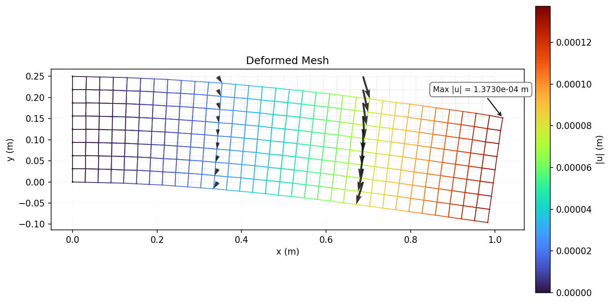

### [Crucible-FEA](https://github.com/ajeet-krish/Crucible-FEA)
**C++ Finite Element Structural Solver**

`C++` `Python`

6 element types · Cholesky + CG solvers · Adaptive refinement

</td>
<td width="33%" align="center">

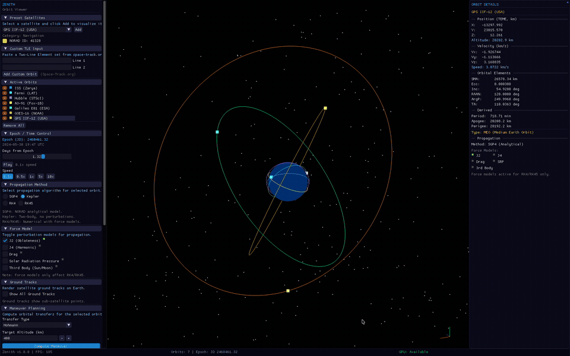

### [Zenith](https://github.com/ajeet-krish/zenith)
**Browser-based Satellite Mission Planner**

`React` `C++`

SGP4 C++ engine · 3D orbit viz · Hohmann transfers · Monte Carlo · Walker constellations

</td>
</tr>
</table>

---

<!-- Project Catalog -->

  

<b>CFD & Aerodynamics</b> (5 projects)

 

<table>
<tr>
<td width="80" align="center">
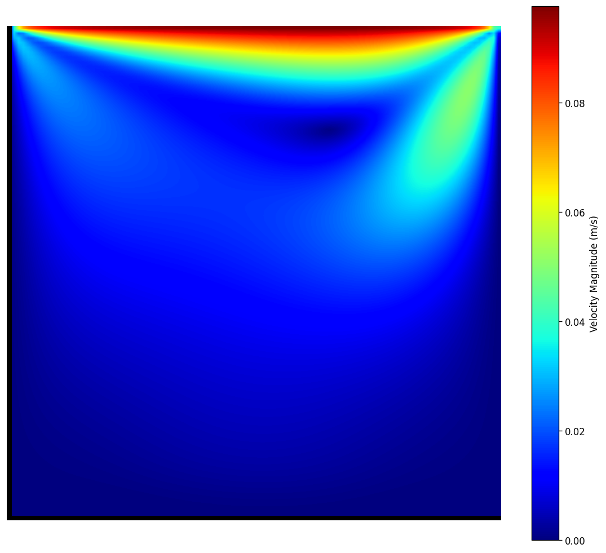
</td>
<td>
<b><a href="https://github.com/ajeet-krish/AK-Vortex">AK-Vortex</a></b> 
<code>C++</code> <code>Rust</code> <code>Python</code> 
LBM CFD solver with MRT, LES, AMR, Rust desktop app, PINN surrogate
</td>
</tr>
<tr>
<td width="80" align="center">
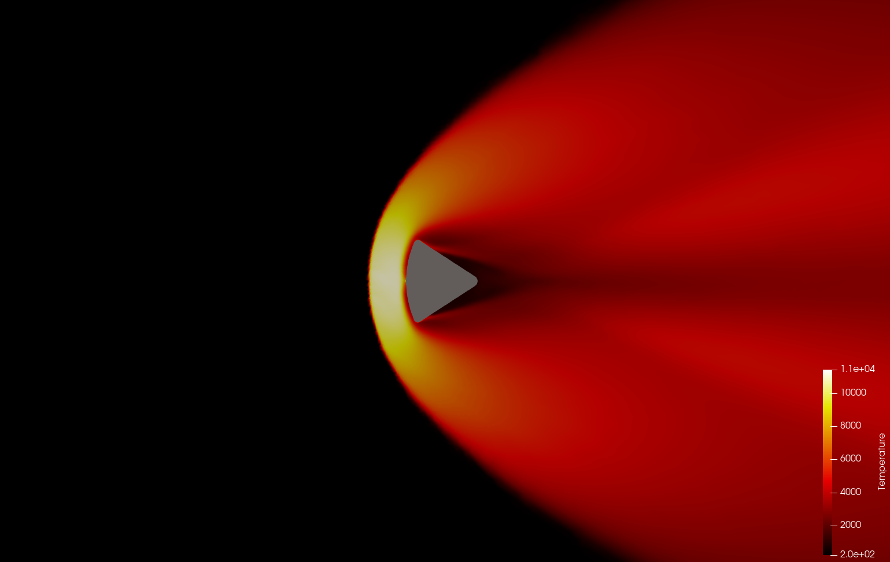
</td>
<td>
<b><a href="https://github.com/ajeet-krish/Hypersonic-Apollo-CFD">Hypersonic Body CFD</a></b> 
<code>Python</code> <code>SU2</code> <code>Gmsh</code> 
Apollo CM re-entry RANS analysis at Mach 5-15.6, validated against analytical solutions
</td>
</tr>
<tr>
<td width="80" align="center">
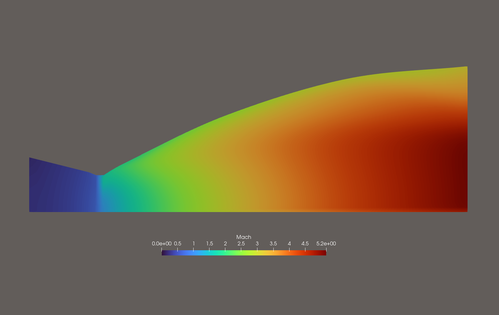
</td>
<td>
<b><a href="https://github.com/ajeet-krish/rocket-nozzle-cfd">Rocket Nozzle CFD</a></b> 
<code>Python</code> <code>SU2</code> <code>Gmsh</code> 
Compressible Euler/RANS analysis of converging-diverging nozzles with triple validation and parametric sweeps
</td>
</tr>
<tr>
<td width="80" align="center">
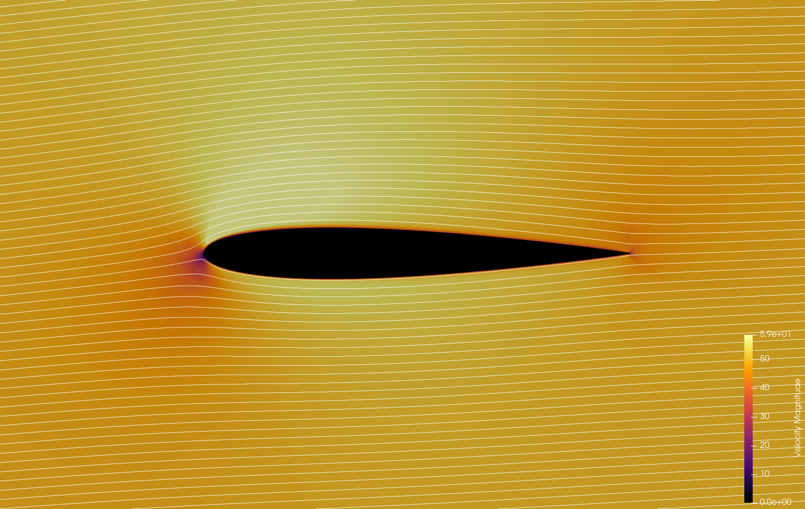
</td>
<td>
<b><a href="https://github.com/ajeet-krish/Airfoil_CFD">Airfoil CFD Explorer</a></b> 
<code>Python</code> <code>SU2</code> <code>Gmsh</code> 
Automated RANS pipeline with NACA 0012 validation and CST shape optimization
</td>
</tr>
<tr>
<td width="80" align="center">
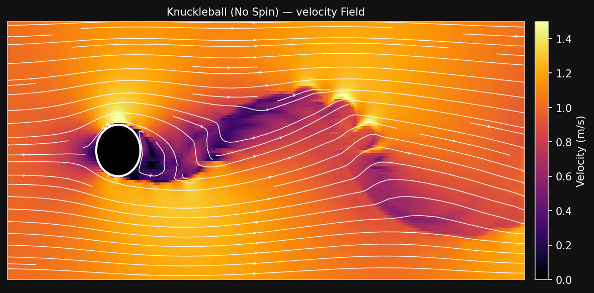
</td>
<td>
<b><a href="https://github.com/ajeet-krish/Soccer-CFD">The Aerodynamics of Soccer</a></b> 
<code>Python</code> <code>PhiFlow</code> <code>SU2</code> 
Magnus effect, vortex shedding, wake drafting, tactical formation flow
</td>
</tr>
</table>

<b>FEA & Structural Analysis</b> (1 project)

 

<table>
<tr>
<td width="80" align="center">
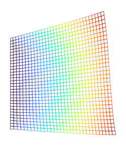
</td>
<td>
<b><a href="https://github.com/ajeet-krish/Crucible-FEA">Crucible-FEA</a></b> 
<code>C++</code> <code>Python</code> 
6-element FEA solver with nonlinear dynamics, contact, desktop app
</td>
</tr>
</table>

<b>CAD & Mechanical Design</b> (1 project)

 

<table>
<tr>
<td width="80" align="center">
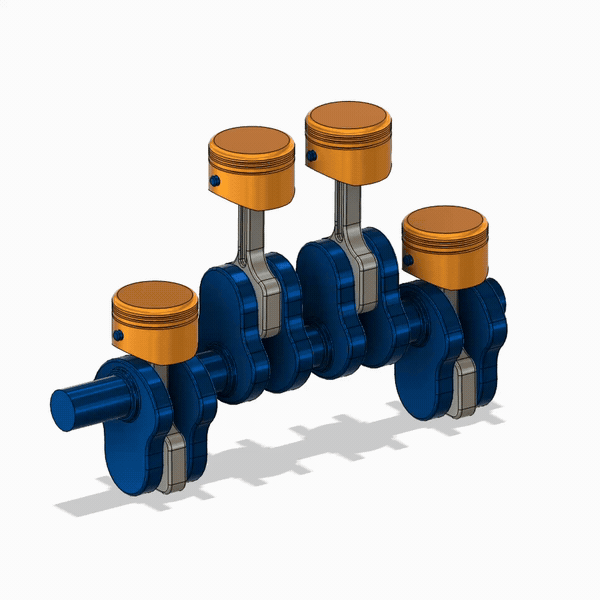
</td>
<td>
<b><a href="https://github.com/ajeet-krish/piston-crankshaft-cad">Piston-Crankshaft CAD</a></b> 
<code>Fusion 360</code> <code>FreeCAD</code> <code>GD&T</code> 
4-piston inline assembly with ASME Y14.5 tolerancing, FEA validation, DFM analysis
</td>
</tr>
</table>

<b>Flight Dynamics & GNC</b> (4 projects)

 

<table>
<tr>
<td width="80" align="center">
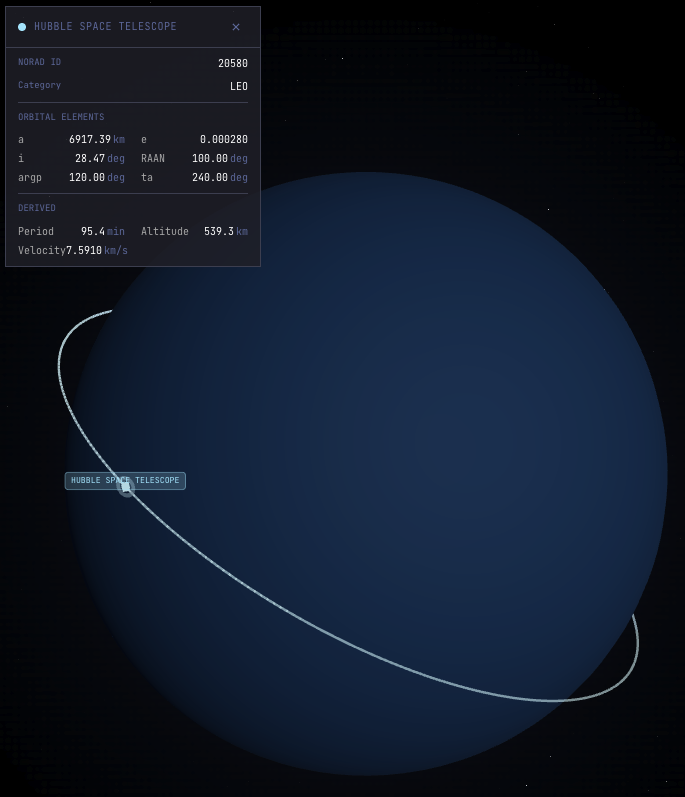
</td>
<td>
<b><a href="https://github.com/ajeet-krish/zenith">Zenith</a></b> 
<code>React</code> <code>C++</code>  
Interactive satellite mission planner and orbital mechanics educational tool.
</td>
</tr>
<tr>
<td width="80" align="center">
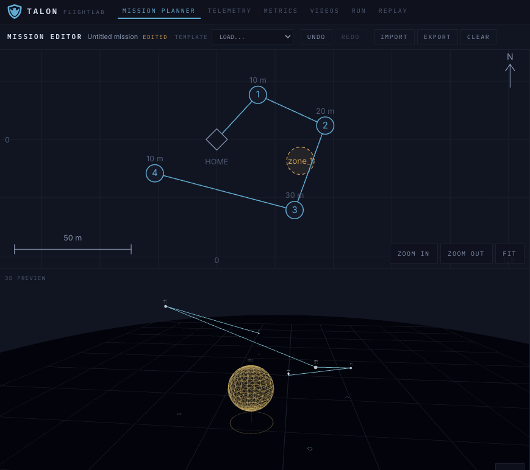
</td>
<td>
<b><a href="https://github.com/ajeet-krish/Talon">Talon</a></b> 
<code>Rust</code> <code>React</code> <code>Python</code> 
Browser UAV autopilot simulator with a Rust GNC core (15-state EKF, NLGL guidance, cascaded PID), 3D flight replay, telemetry, and MAVLink software-in-the-loop
</td>
</tr>
<tr>
<td width="80" align="center">
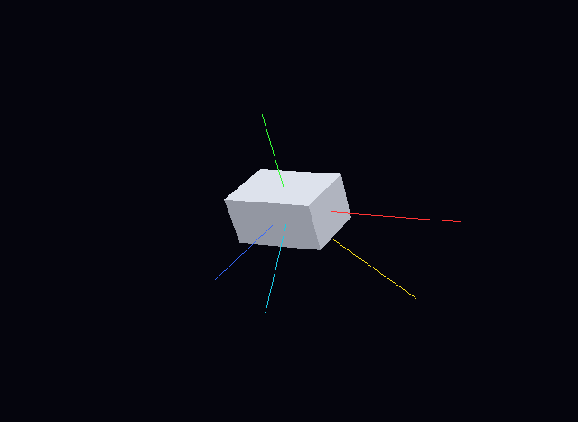
</td>
<td>
<b><a href="https://github.com/ajeet-krish/AstroSim">AstroSim</a></b> 
<code>C++</code> <code>Python</code> 
ADCS simulator with sensor models, EKF attitude determination, FDIR
</td>
</tr>
<tr>
<td width="80" align="center">
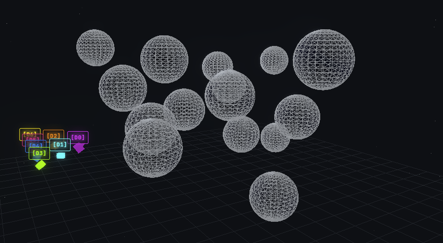
</td>
<td>
<b><a href="https://github.com/ajeet-krish/SwarmGNC">SwarmGNC</a></b> 
<code>C++</code> <code>Python</code> <code>Rust</code> 
7-drone swarm, LQR, APF, FDIR, Rust GCS
</td>
</tr>
</table>

<b>Competitions</b> (2 projects)

 

<table>
<tr>
<td width="80" align="center">
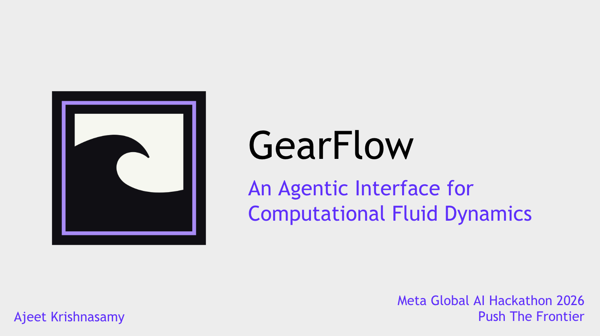
</td>
<td>
<b><a href="https://github.com/ajeet-krish/gearflow">GearFlow</a></b> 
<code>React</code> <code>TypeScript</code> <code>Python</code> <code>Rust</code> 
Meta Global AI hackathon: agentic interface where an AI sets up, runs, and explains CFD simulations from plain language
</td>
</tr>
<tr>
<td width="80" align="center">
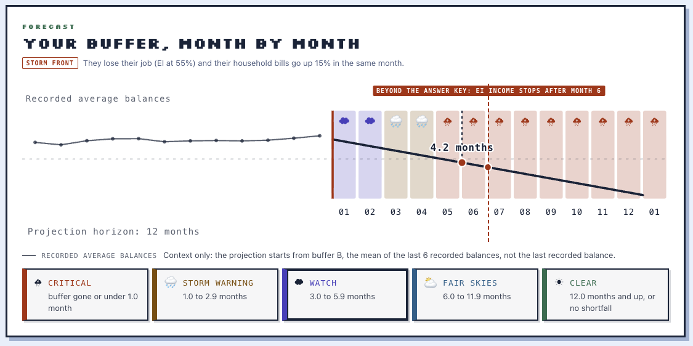
</td>
<td>
<b><a href="https://github.com/ajeet-krish/stormfund">Storm Fund</a></b> 
<code>Python</code> <code>React</code> 
Sheridan Datathon: visualizes a bank account as a live weather forecast with runway analysis and shock simulation
</td>
</tr>
</table>

<b>Hobbies</b> (1 project)

 

<table>
<tr>
<td width="80" align="center">
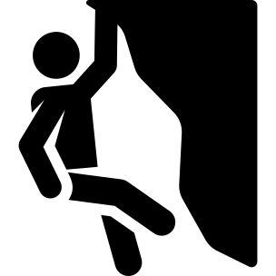
</td>
<td>
<b><a href="https://github.com/ajeet-krish/cybersend">CyberSend</a></b> 
<code>Swift</code> <code>SwiftUI</code> <code>Core ML</code> 
Local-first iOS bouldering logbook: sessions, grades, photo tagging, on-device pose ML, zero accounts
</td>
</tr>
</table>

---

<!-- Tech Stack -->

  

| Domain | Technologies |
|--------|-------------|
| **CAD/CFD** | SolidWorks · Autodesk Fusion · FreeCAD · ANSYS · SU2 · OpenFOAM |
| **Languages** | C++ · Python · Rust · MATLAB |
| **ML/AI** | PyTorch · Physics-Informed Neural Networks · Computer Vision · AI Agent Harnesses |
| **Manufacturing** | CNC Machining · 3D Printing · Lathe/Mill Operations · MIG Welding |

  <picture>
    <source media="(prefers-color-scheme: dark)" srcset="https://raw.githubusercontent.com/ajeet-krish/ajeet-krish/output/github-snake-dark.svg">
    <source media="(prefers-color-scheme: light)" srcset="https://raw.githubusercontent.com/ajeet-krish/ajeet-krish/output/github-snake.svg">
    
  </picture>

---

<!-- Let's Connect -->

  

  
  
  

Always open to new opportunities and engineering problems!

